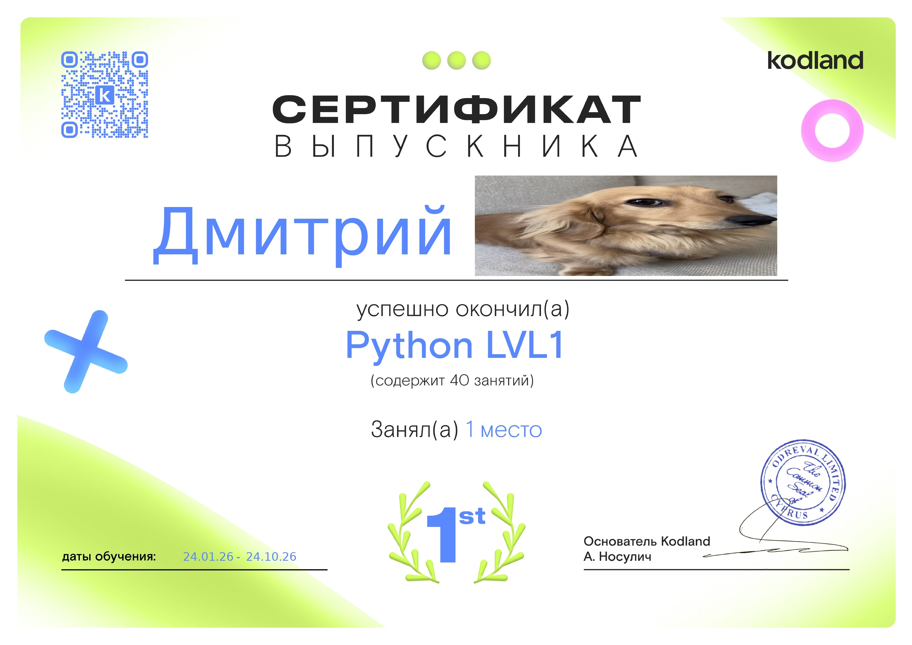

<table border="0" cellspacing="0" cellpadding="10">
  <tr>
    <!-- ЛЕВАЯ КОЛОНКА: Текст -->
    <td width="50%" valign="top">
      <h2 align="center">Hello!</h2>
      <h3 align="center">I'm Dmitry, a 13-year-old python developer 🍀</h3>
      
       
      
      <ul>
        <li><b>🐍 Окончил школу Python LVL 1 в Kodland с 1-м местом!</b></li>
        <li><b>🌿 Сейчас продолжаю обучение на курсе Python Pro</b></li>
        <li><b>🌵 Активно учу английский язык.</b></li>
      </ul>

        
      
      <h2 align="center"><b>Достижения:</b></h2>
    </td>

    <!-- ПРАВАЯ КОЛОНКА: Картинка -->
    <td width="50%" valign="top" align="center">
      <!-- Твоя зеленая свинка -->
      
    </td>
  </tr>
</table>

 

<!-- Твой сертификат по центру снизу -->

  

 

  <!-- Кнопки соцсетей -->
  
  

